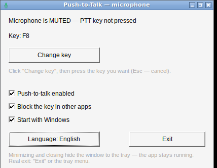

# Push-to-Talk — microphone on a key (Windows)

A tiny Windows app that turns a key on your keyboard into a **push-to-talk button for your
microphone**. Hold the key — the mic is live. Release it — the mic is muted.
Turn the feature off and the mic stays live all the time (no key needed), while the app keeps
running quietly in the tray.

Русское описание (main): [README.md](README.md)



**Download:** grab `PushToTalk.exe` from the [latest release](../../releases/latest) — one file,
no installer, no Python, no .NET, nothing else to install.

## What it does

* **Push-to-talk on any key** — default is **HOME**, you can rebind it to anything.
* **Turn PTT off** — then the microphone is always live; the app stays in the process list and
  in the tray, it does not close.
* **Tray icon** — closing the window (X) or minimizing it hides the app into the tray instead of
  exiting. Icon colour shows the state: green = mic live, red = muted, grey = mic unavailable.
* **Start with Windows** — one checkbox (no administrator rights needed).
* **RU / EN interface** — one button to switch.
* **Block the key in other apps** — optional: while PTT is on, the key is used only as a
  push-to-talk button and does not reach the game or browser.

## How it works

* The mic is muted/unmuted through the Windows **Core Audio API**
  (`IAudioEndpointVolume::SetMute`) on the default recording device. That is the same mute you
  see when you press "mute" on the microphone in Windows sound settings, so **every program sees
  it** — Discord, Skype, games, browsers, voice recorders.
* The PTT key is caught by a **global low-level keyboard hook** (`WH_KEYBOARD_LL`), so it works
  in any window. When push-to-talk is switched off, the hook is removed completely — the app does
  not intercept the keyboard at all.
* The microphone is always un-muted on start and on exit, so it never stays silent after you
  close the app.

## Usage

1. Put `PushToTalk.exe` somewhere permanent, e.g. `C:\Users\<you>\Apps\PushToTalk\`
   (autostart stores the path to the file, so it is best not to move it afterwards).
2. Run it.
3. Optional: tick **Start with Windows** (writes to `HKCU\...\CurrentVersion\Run`, no admin rights).
4. Hold your key while you want to be heard.

Settings window buttons:

| Control | What it does |
|---|---|
| Change key | Click, then press the key you want (Esc cancels) |
| Push-to-talk enabled | Untick to keep the mic always live |
| Block the key in other apps | Untick if the same key is also needed as a normal key |
| Start with Windows | Autostart |
| Language | RU / EN |
| Exit | Real exit (the X button only hides to tray) |

Tray menu: *Open settings*, *Toggle push-to-talk*, *Exit*.

## Settings and logs

* Settings: `%APPDATA%\PushToTalk\config.ini`
* Log: `%APPDATA%\PushToTalk\log.txt` — every start, key press/release, mic mute/unmute and any
  error is written there, so it is the first place to look if something misbehaves.

There is also `PushToTalk_selftest.exe` (diagnostics):

```
PushToTalk_selftest.exe            full self-test (16 checks)
PushToTalk_selftest.exe --get      print the microphone mute state
PushToTalk_selftest.exe --mute     mute the microphone
PushToTalk_selftest.exe --unmute   unmute the microphone
```

## Built with

* **C**, plain **Win32 API** — no frameworks, no runtime dependencies. The whole app is one
  ~100 KB `PushToTalk.exe`.
* Core Audio API (`IAudioEndpointVolume`) for the microphone, `Shell_NotifyIcon` for the tray,
  `WH_KEYBOARD_LL` for the global key, `RegCreateKeyEx` for autostart, INI file for settings.
* Cross-compiled with **mingw-w64** (`x86_64-w64-mingw32-gcc`); icons generated by
  `src/make_icons.py`. Requirements: Windows 10 / 11, 64-bit.

## Build from source

```sh
cd src
x86_64-w64-mingw32-windres app.rc -o app_res.o
x86_64-w64-mingw32-gcc -O2 -mwindows ptt_mic.c app_res.o -o PushToTalk.exe \
    -lole32 -lshell32 -luser32 -lgdi32 -lcomctl32 -static -s
```

or simply run `src/build.sh` (also builds `PushToTalk_selftest.exe`).

## Notes

* The .exe is not code-signed, so SmartScreen may warn about an unknown publisher:
  *More info → Run anyway*.
* If you kill the process from Task Manager while PTT is on and no key is held, the microphone
  can stay muted. Just start the app again — it always unmutes on start.
* The app was developed and tested end-to-end under Wine 9 (self-test 16/16 + GUI, tray,
  autostart and key handling checks). Issues and pull requests are welcome.

## License

MIT — see [LICENSE](LICENSE).
