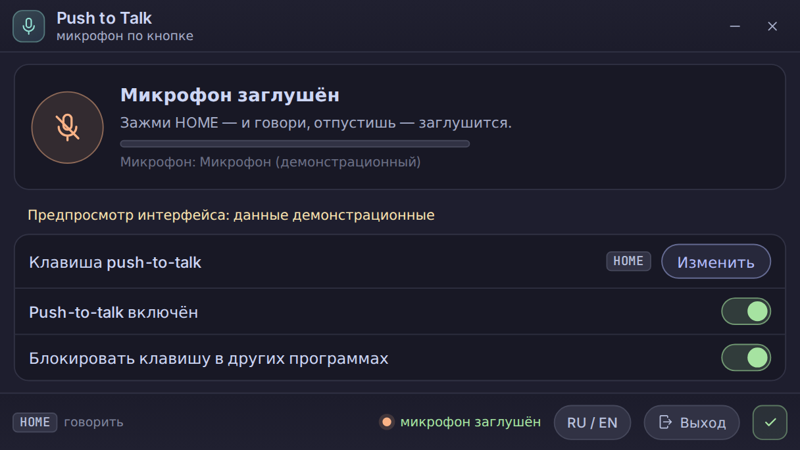

# Push to Talk

Push-to-talk microphone for Windows: hold a key to talk, release to mute. The app lives in
the tray and stays out of the way.

[Русская версия →](README.md)



## Features

* The microphone stays muted until you hold the push-to-talk key (default **HOME**).
* The key is changed right in the window: "Change" → press the key you want (Esc cancels).
* Push-to-talk can be turned off — the microphone then stays always live.
* Key blocking: with the switch on, the key does not reach a game or editor.
* Start with Windows — the green tick in the bottom-right corner of the window.
* Tray: the icon shows the microphone state (live / muted / no device), a single left click
  opens the window, right click opens the menu (settings, toggle PTT, exit).
* Signal level meter and recording device name — you can see the microphone really hears you.
* UI language RU / EN — the button in the footer, it also switches the tray menu.
* The close button, minimizing and Esc hide the window to the tray; the real exit is
  "Exit" in the window or in the tray menu.
* The window is compact, 16:9: the app mainly runs in the tray, so the size is meant for
  opening, checking and closing.

## Requirements

Windows 10 or 11. The WebView2 Runtime component is required — it already ships with Edge on
Windows 10/11. Nothing else: the .NET runtime and the interface are inside the exe.

## Install

1. Download `PushToTalk.exe` from the [latest release](../../releases/latest).
2. Run it — the app appears in the tray (a microphone icon).
3. On the first launch the microphone is muted; it goes live while you hold the PTT key.

## Settings and log

* `%APPDATA%\PushToTalk\config.ini` — key, PTT on/off, key blocking, language. It can be edited
  by hand, but normally everything is changed in the window.
* `%APPDATA%\PushToTalk\log.txt` — startup, PTT key presses, microphone switches, errors.
* Autostart: `HKCU\Software\Microsoft\Windows\CurrentVersion\Run`, value `PushToTalk`.

## How it works

The app subscribes to the keyboard (WH_KEYBOARD_LL), so it sees the PTT key in any application,
not only when its window is focused. While the key is held, the microphone is unmuted through
CoreAudio (communications and default devices); on release it is muted again. The microphone
state is checked once a second, so changes made by other apps are reflected as well.

## Build

You need the .NET SDK 8 (the official Microsoft one) and this command:

```
dotnet publish -c Release -r win-x64
```

The result is a single exe with both the logic and the interface inside. The interface lives in
`ui/` — you can open it in a browser (`ui/preview.html`) to look at it without building.

## Changelog

[CHANGELOG.md](CHANGELOG.md)

## License

MIT. The sources of the first version (C/Win32) are in `legacy-c/`.
