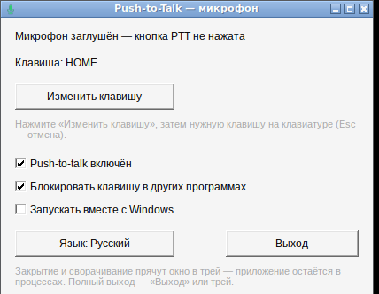

# Push-to-Talk — микрофон под кнопку (Windows)

Маленькое приложение для Windows, которое превращает любую клавишу в **рацию для микрофона**.
Держишь клавишу — микрофон включён, отпустил — заглушён. Если функция не нужна, её можно
выключить: тогда микрофон работает постоянно, без нажатий, а приложение продолжает висеть в
процессах и в трее.

English description: [README.md](README.md)



**Скачать:** `PushToTalk.exe` из [последнего релиза](../../releases/latest) — один файл, без
установщика, без Python, без .NET и без других зависимостей.

## Что умеет

* **Push-to-talk на любой клавише** — по умолчанию **HOME**, можно переназначить на что угодно.
* **Выключить PTT** — микрофон работает всегда, а приложение не закрывается, а остаётся в
  процессах и в трее.
* **Трей** — закрытие окна (крестик) и сворачивание прячут приложение в трей, а не закрывают его.
  Цвет значка: зелёный — микрофон активен, красный — заглушён, серый — микрофон недоступен.
* **Запуск вместе с Windows** — одна галка (права администратора не нужны).
* **Русский / английский интерфейс** — переключается одной кнопкой.
* **Блокировка клавиши в других программах** — по желанию: клавиша работает только как рация и
  не улетает в игру или браузер.

## Как это работает

* Микрофон глушится через **Core Audio API** Windows (`IAudioEndpointVolume::SetMute`) на
  устройстве записи по умолчанию. Это тот же mute, что и в настройках звука Windows, поэтому его
  **видят все программы**: Discord, Skype, игры, браузер, диктофон.
* Клавишу PTT ловит **глобальный низкоуровневый хук клавиатуры** (`WH_KEYBOARD_LL`), поэтому она
  срабатывает в любом окне. Когда push-to-talk выключен, хук снимается совсем — клавиатура вообще
  не перехватывается.
* При старте и при выходе mute всегда снимается, чтобы микрофон не остался заглушённым.

## Как пользоваться

1. Положите `PushToTalk.exe` в постоянную папку, например
   `C:\Users\<вы>\Apps\PushToTalk\` (в автозапуск пишется путь к файлу, поэтому потом лучше его
   не переносить).
2. Запустите.
3. По желанию поставьте галку **«Запускать вместе с Windows»** (пишется в
   `HKCU\...\CurrentVersion\Run`, права администратора не нужны).
4. Держите клавишу, когда нужно, чтобы вас слышали.

Кнопки в окне:

| Элемент | Что делает |
|---|---|
| Изменить клавишу | Нажать, потом нажать нужную клавишу (Esc — отмена) |
| Push-to-talk включён | Снять галку, чтобы микрофон работал постоянно |
| Блокировать клавишу в других программах | Снять, если эта клавиша нужна и как обычная |
| Запускать вместе с Windows | Автозапуск |
| Язык | RU / EN |
| Выход | Полный выход (крестик окна только прячет в трей) |

Меню в трее: «Открыть настройки», «Push-to-talk вкл/выкл», «Выход».

## Настройки и логи

* Настройки: `%APPDATA%\PushToTalk\config.ini`
* Лог: `%APPDATA%\PushToTalk\log.txt` — туда пишутся запуск, нажатия/отпускания клавиши,
  заглушение и снятие mute, ошибки. Это первое место, где смотреть, если что-то не так.

Есть ещё `PushToTalk_selftest.exe` (диагностика):

```
PushToTalk_selftest.exe            полный самотест (16 проверок)
PushToTalk_selftest.exe --get      показать состояние mute микрофона
PushToTalk_selftest.exe --mute     заглушить микрофон
PushToTalk_selftest.exe --unmute   снять mute
```

## На чём написано

* **C** и чистый **Win32 API** — никаких фреймворков и зависимостей от среды выполнения, всё
  приложение это один `PushToTalk.exe` примерно на 100 КБ.
* Core Audio API (`IAudioEndpointVolume`) — микрофон, `Shell_NotifyIcon` — трей,
  `WH_KEYBOARD_LL` — глобальная клавиша, реестр — автозапуск, INI-файл — настройки.
* Собирается кросс-компилятором **mingw-w64** (`x86_64-w64-mingw32-gcc`), иконки рисует
  `src/make_icons.py`. Требования: Windows 10 / 11, 64-бит.

## Сборка из исходников

```sh
cd src
x86_64-w64-mingw32-windres app.rc -o app_res.o
x86_64-w64-mingw32-gcc -O2 -mwindows ptt_mic.c app_res.o -o PushToTalk.exe \
    -lole32 -lshell32 -luser32 -lgdi32 -lcomctl32 -static -s
```

или просто запустить `src/build.sh` (соберёт ещё и `PushToTalk_selftest.exe`).

## Заметки

* Exe не подписан сертификатом, поэтому SmartScreen может предупредить о неизвестном издателе:
  «Подробнее» → «Выполнить в любом случае».
* Если убить процесс через «Диспетчер задач», когда PTT включён и клавиша не нажата, микрофон
  может остаться заглушённым. Просто запустите приложение заново — при старте mute снимается.
* Приложение разработано и полностью проверено под Wine 9 (самотест 16/16 + проверки GUI, трея,
  автозапуска и обработки клавиш). Замечания и pull request'ы приветствуются.

## Лицензия

MIT — см. [LICENSE](LICENSE).
